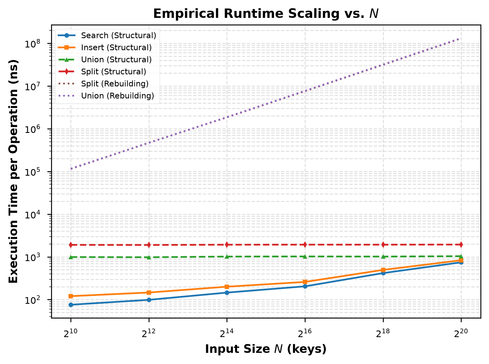
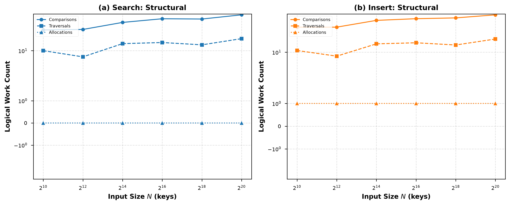
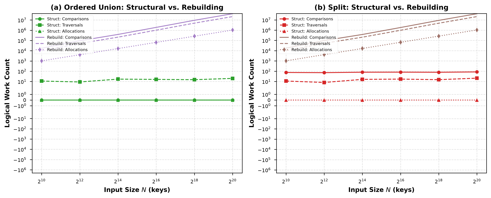

# Skip List Implementation in C++

## Project Overview & Architecture

The following is a **C++** based implementation of the Randomized Data Structure known as **"Skip List"**. The following **Default Seed** is provided:
```c++
// Seed
using seed_t = u_int64_t;
inline constexpr seed_t SEED_DEFAULT{17};
```

The implementation makes use of **distinct signed 64-bit integer Keys**, with the following representation of the **Sentinel Key**:
```c++
// Key
using key_t = int64_t;
inline constexpr key_t SENTINEL_KEY{std::numeric_limits<key_t>::min()};
```

**Node Heights are independently sampled**, with a **Default Height Promotion Probability** of:
```c++
// Probability
using prob_t = double;
inline constexpr prob_t PROB_DEFAULT{0.5};
```

**Node Heights are capped to avoid Probabilistic Anomalies and Unbounded Growth**, with a **Default Maximum Height** of:
```c++
// Height
using height_t = u_int8_t;
// NOTE: Under ideal conditions, height = log(n) <= log(2 ** 64) = 64
inline constexpr height_t MAX_HEIGHT_DEFAULT{64};
```

In addition to having default values, **both the Seed, the Height Promotion Probability and the Maximum Height can be configured manually when initializing the Skip List**.

The following is the representation that has been chosen for the **Nodes**:
```c++
// Skip List Node
struct Node {
    key_t key;
    height_t height;
    std::vector<Node*> next;

    // ...
};
```

Each Node contains its **Key** and **Height** values, as well as a **Vector of Pointers to the next Nodes: the number of Pointers is equal to the Height of the Node**.

Please note that **the Sentinel itself is also represented as an ordinary Node**.

Lastly, here follows the representation that has instead been chosen for the **Skip List** itself, including its **Public Interface**:
```c++
// Skip List
class SkipList {
public:
    // ...
    
    // Ordered Union
    static SkipList ordered_union(SkipList&& A, SkipList&& B);

    // Rebuilding Ordered Union
    static SkipList rebuilding_ordered_union(SkipList&& A, SkipList&& B);

    // Constructor
    explicit SkipList(height_t max_height = MAX_HEIGHT_DEFAULT, prob_t p = PROB_DEFAULT, seed_t seed = SEED_DEFAULT);

    // Copy Constructor
    SkipList(const SkipList&) = delete;
    SkipList& operator=(const SkipList&) = delete;

    // Move Constructor
    SkipList(SkipList&& other) noexcept;
    SkipList& operator=(SkipList&& other) noexcept;

    // Destructor
    ~SkipList();

    // Seed
    void seed(const seed_t seed) const;

    // Get head
    const Node* get_head() const;

    // Check if empty
    bool is_empty() const;

    // Get height
    height_t get_height() const;

    // Clear
    void clear();

    // Search
    bool search(key_t key) const;

    // Insert
    bool insert(key_t key);

    // Erase
    bool erase(key_t key);

    // Split
    std::pair<SkipList, SkipList> split(key_t pivot);

    // Rebuilding Split
    std::pair<SkipList, SkipList> rebuilding_split(key_t pivot);

    // Check invariants
    bool check_invariants() const;

private:
    Node* sentinel;
    height_t max_height;
    prob_t p;
    mutable rng_t rng;
    
    // ...
} 
```

Optionally, **when the library is compiled in Debug Mode and the Instrumentation is enabled**, the following **Logical Work Metrics can be collected** during execution:
```c++
// Metric
using metric_t = uint64_t;

// Instrumentation Metrics
static inline bool instrument_active{false};
static inline metric_t op_comparisons{0};
static inline metric_t op_traversals{0};
static inline metric_t op_allocations{0};
```

This is achieved through the use of **Macros**, which turn the corresponding operations into NOPs, ensuring that **the Performance of the library isn't affected in Release Mode**.

## Dependencies & Requirements

The project is built using **CMake**, therefore the following Dependencies are required:
- **CMake 4.3** (or above)
- **C++20** (or above) and **relevant compiler** (gcc, clang, ...)

In order to set up the **Python Environment** required to plot the results, the following Dependencies are also required:
- **uv 0.13.4** (or above) 
- **Python 3.12** (or above)

Please note that **the relevant required C++ (benchmark) and Python (numpy, pandas, matplotlib) libraries will automatically be downloaded by the respective Build Systems**.

**Valgrind and other Sanitizers must be installed separately**, if one wishes to repeat that part of the Testing process, **but are not required to build and run the library**.

## Build & Run

In order to correctly build the Source Code and run the Code properly, please follow the following instructions.

Clone the Repository and set up your Working Directory:
```bash
git clone git@github.com:sky-guard/skip_list.git
cd skip_list
```

In order to run the Tests, generate a Debug Build Directory, build the following Target and then run it:
```bash
cmake -B cmake-build-debug -DCMAKE_BUILD_TYPE=Debug
cmake --build cmake-build-debug --target skip_list_test -j $(nproc)
./cmake-build-debug/skip_list_test
```

In order to run the Benchmarks, generate a Release Build Directory, build the following Target and then run it:
```bash
cmake -B cmake-build-release -DCMAKE_BUILD_TYPE=Release
cmake --build cmake-build-release --target skip_list_benchmark -j $(nproc)
./cmake-build-release/skip_list_benchmark --benchmark_out=results.json --benchmark_out_format=json
```

In order to generate the Plots, synchronize your Virtual Environment to download all the necessary Dependencies, move over the necessary JSON Outputs, change your Working Directory and then run the following script:
```bash
uv sync
mv results.json src/plots
mv logical_work.json src/plots
cd plots
uv run plot.py
```

## Operation Contracts & Ownership Rules

**All four of the Structural Operations (search, insert, ordered_union, split) have been implemented with an efficient $O(log(n))$ Time Complexity and $O(1)$ Node Allocations**. These are indeed the targeted theoretical results, which have been achieved and put into practice.

This means: **no rebuilding, no reinsertion, no copying**. 

**All Node Addresses and Heights are preserved**.

In the case of **consuming Operations (ordered_union, split)**, **the consumed Inputs remain valid, empty and reusable: Outputs acquire ownership over their Nodes**.

**Each allocated Node is freed exactly once**, preventing **Memory Leaks**.

## Theoretical Complexity Analysis

**Skip Lists maintain the same probabilistic balance analogous to other Randomized Data Structures, such as Treaps**. Therefore, **we have the same expected Time Complexity guarantees**:
- **search and insert ~ $O(\log(n))$**: Traverse the Skip List from the highest Height level, moving horizontally across and dropping down a level when encountering a larger Key or null. **Because the expected Height is $O(log(n))$ and the expected number of steps per level is bounded by a Constant, both Search and Insert Operations execute in $O(\log(n))$ expected Time Complexity**.
- **ordered_union ~ $O(\log(n+m))$**: Since inputs are disjoint and pre-sorted, Structural Ordered Union bypasses re-insertions entirely by rewiring the Tail Pointers of the first list into the Head of the second list across all corresponding Height levels. **Searching for the Tail of a Skip List is $O(log(n))$, as is rewiring a Node's Pointers, therefore the expected Time Complexity is of $O(\log(n+m))$**.
- **split ~ $O(\log(n))$**: Like before, **searching for the Pivot and rewiring a Node's Pointers at the split boundary to divides the list into two independent sub-lists are both $O(log(n))$ Operations. Therefore, the expected Time Complexity is $O(log(n))$**.

Additionally, as for the **Space Complexity**:
- **Storage ($O(n)$)**: Each node of Height $h$ contains $h$ forward Pointers. Since Node Heights follow a geometric distribution where the probability of a Node having Height $h$ is $p^h$, **the expected Height (and Pointer count) per Node is $\sum_{h=0}^{\infty} p^{h} = 1/p$**. Thus, **total Memory overhead scales linearly with $n/p$ Pointers, ensuring an expected Space Complexity of $O(n)$**. 

## Structural VS Rebuilding Operations

In addition to the Structural Operations, **a baseline Rebuilding version of the ordered_union and split Operations has also been provided and used during testing to verify the expected results**. This was done to confirm that indeed **the baseline Rebuilding versions of the previously mentioned Operations are much slower than the Structural ones, demonstrating a $O(nlog(n))$ Time Complexity and $O(n)$ Node Allocations**.

The following Plot proves the previously made claims:



Indeed, we can see a **clear Logarithmic trend for both the ordered_union (in red) and split (in green) Operations: they appear as a flat horizontal line in the log-log Plot**. Please note that **the Plot uses very different bases for the two axes, therefore a Logarithmic trend appears as basically flat instead of curving downwards in this particular case**.

**The search (in blue) and insert (in orange) Operations follow closely after: while their trend isn't a perfectly straight line like in the previous case, it is still very far from being Linear**. This minor discrepancy can probably be attributed to effect of **Caches**: **as these Operations rely on pointer chasing much more than the previous two, the increasing cost of Cache Misses (which naturally start to occur more and more often as the Input Size keeps growing and the entire Data Structure can no longer be fit into the faster L1 - L2 Caches, but rather has to be spilled to the slower L3 Cache) very likely begins to take over**.

**The Rebuilding ordered_union (in purple) and Rebuilding split (in brown) show a completely different trend: they shoot up with a straight line with unary coefficient, which in a log-log Plot is a clear indicator of a $O(nlog(n))$ Complexity**, thus proving the expected theoretical results. Once again, **please note that the reason why the Log-Linear trend appears like a straight line instead of a line curving upwards is due to the different scales of the two axes**.

## Logical Work Comparison

**In addition to the Runtime Scaling Tests, additional Tests focusing on Logical Work were also conducted**. 

The aim of these Tests was to **collect additional Instrumentation Metrics as a second form of proof of the Logarithmic Complexity of the Structural Operations, as opposed to the Linear or Log-Linear Complexity of the Rebuilding ones**. 

The following Instrumentation Metrics were collected:
```c++
// Instrumentation Metrics
static inline metric_t op_comparisons{0};
static inline metric_t op_traversals{0};
static inline metric_t op_allocations{0};
```

Let's analyze the plotted results for the **Structural versions of search and insert**:



**On the left, we can see the three Instrumentation Metrics plotted for the Structural search (in blue)**: as expected, **we can see that no Allocations were made and that the Comparisons and Traversals follow pretty much a horizontal line, confirming a Logarithmic trend**.

**On the right, we can see the three Instrumentation Metrics plotted for the Structural insert (in orange)**: as expected, **we can see that only one Allocation was made and that the Comparisons and Traversals again follow pretty much a horizontal line, confirming the same Logarithmic trend**.

Let's analyze the plotted results for the **Structural VS Rebuilding versions of ordered_union and split**:



**On the left, we can see the three Instrumentation Metrics plotted for both the Structural ordered_union (in green) and the Rebuilding ordered_union (in purple)**. **For the Structural version, we can see a very clear Logarithmic trend (horizontal line) for the Traversals, while both Comparisons and Allocations are zero**, as expected. On the other hand, **for the Rebuilding version, we can identify a clear Linear trend (straight line, unary coefficient) for the Allocations and a Log-Linear trend (straight line, coefficient > 1) for the Comparisons and Traversals, caused by the repeated Insertions**.

**On the right, we can instead see the three Instrumentation Metrics plotted for both the Structural split (in red) and the Rebuilding split (in brown)**. Following the same reasoning as before, **we can identify Logarithmic Comparisons and Traversals and zero Allocations for the Structural version**. On the other hand, **the Rebuilding version shows Linear Allocations and Log-Linear Comparisons and Traversals**, just as we expected.

## Correctness Verification & Testing

In order to ensure functional correctness, **extensive testing has been performed during the development process**. 

The Source Code indeed includes a **dedicated executable for running such Tests, which additionally also generates a JSON Output File for collecting the Instrumentation Metrics used to generate the previous Plots when ran in Debug Mode**. 

The provided executable contains and executes the following Tests:
```c++
// Run all Tests sequentially, one after the other
static void run_tests() {
    // ...

    // Run Generic Operations Test
    test_generic_operations();

    // Run Clear Method Test
    test_clear_method();

    // Run Boundary Keys Test
    test_boundary_keys();

    // Run Empty and Singleton Test
    test_empty_and_singleton();

    // Run Split Edge Cases Test
    test_split_edge_cases();

    // Run Ordered Union Edge Cases Test
    test_ordered_union_edge_cases();

    // Run Rebuilding Operations Test
    test_rebuilding_operations();

    // Run Reusability of Consumed Inputs Test
    test_reuse_consumed_inputs();

    // Run Address and Height Preservation Test
    test_address_and_height_preservation();

    // Run Randomized Seeds Test (1500+ Operations)
    test_randomized_seeds();

    // Run Complexity Instrumentation Test and generate JSON Output
    test_complexity_instrumentation();
    
    // ...
}
```

When needed, **the following Reference Container is used to compare the output of any given Operation**:
```c++
std::set<key_t> ref;
```

In order to facilitate Testing, **the Skip List Public Interface also includes the following method to check that all the Invariants are satisfied**:
```c++
// Check invariants
bool check_invariants() const;
```

The Invariants for the Skip List that are checked are the following:
- **Absence of Cycles**
- **Strictly increasing Keys**
- **All Nodes present at the bottom level**
- **Node Height Consistency**

Additionally, **the previously mentioned executable has also been run and checked against Valgrind, AddressSanitizer and UndefinedBehaviorSanitizer**. Thus, **confirming the absence of Memory Leaks, Memory Corruptions and Undefined Behavior**.

## Benchmarks & Performance

In order to ensure that the target theoretical Complexity was achieved in practice, **the Code has also been subjected to extensive benchmarking during the development process**. The benchmarking platform that was chosen for this is **Google Benchmark**.

The Source Code indeed includes a **dedicated executable for running such Benchmarks, which additionally also generates a JSON Output File for collecting the Benchmarking Metrics used to generate the previous Plots when ran in Release Mode**. 

All Benchmarks have been carried out across **six geometrically spaced Input Sizes, spanning from $N = 2^{10}$ to $N = 2^{20}$, using three different Seeds in order to properly capture the Randomness aspect of the Data Structure, as well as multiple repetitions per Seed**:
```c++
// Register benchmarks with geometric sizes and multiple Seeds
// Sizes: 2^10 to 2^20 (6 sizes), Seeds: {17, 42, 1337} (3 seeds)
#define BENCHMARK_CONFIG(func) \
    BENCHMARK(func) \
        ->Args({1 << 10, 17})->Args({1 << 10, 42})->Args({1 << 10, 1337}) \
        ->Args({1 << 12, 17})->Args({1 << 12, 42})->Args({1 << 12, 1337}) \
        ->Args({1 << 14, 17})->Args({1 << 14, 42})->Args({1 << 14, 1337}) \
        ->Args({1 << 16, 17})->Args({1 << 16, 42})->Args({1 << 16, 1337}) \
        ->Args({1 << 18, 17})->Args({1 << 18, 42})->Args({1 << 18, 1337}) \
        ->Args({1 << 20, 17})->Args({1 << 20, 42})->Args({1 << 20, 1337}) \
        ->UseManualTime() \
        ->Complexity(benchmark::oLogN)
```

Please note that **Manual Timing was enabled in order to avoid the interference of Destructors and other Operations during the Critical Timed Section of the Benchmarks**.

The provided executable contains and executes the following Benchmarks:
```c++
// Register benchmarks
BENCHMARK_CONFIG(BM_SkipListSearch);
BENCHMARK_CONFIG(BM_SkipListInsert);
BENCHMARK_CONFIG(BM_SkipListOrderedUnion);
BENCHMARK_CONFIG(BM_SkipListSplit);
BENCHMARK_CONFIG(BM_SkipListSplitRebuilding);
BENCHMARK_CONFIG(BM_SkipListOrderedUnionRebuilding);
```

**The provided Logarithmic Complexity Model was able to fit quite nicely to all four Structural Operations**:
- **search and insert Operations achieved an RMS of around 50%**: not the lowest, but within reasonable bounds and probably caused by Pointer Chasing and Cache Misses.
- **ordered_union and split Operations achieved an RMS of around 20%**: a very clean fit to the theoretical result.

Meanwhile, **Rebuilding Operations failed to fit to the provided Logarithmic Complexity Model: RMS spiked up and above 150%, a clear sign that this version of the Operations is unable to achieve $O(log(n))$ Time Complexity**. **Testing a Linear Complexity Model instead, revealed a much lower RMS value of 10%**: a definite proof of our hypothesis.

| Benchmark                    | Time Coefficient ($O(\log N)$) | Time RMS (%) | CPU Coefficient ($O(\log N)$) | CPU RMS (%) |
|------------------------------|--------------------------------|--------------|-------------------------------|-------------|
| **Search**                   | 22.13                          | 66%          | 23.71                         | 59%         |
| **Insert**                   | 25.26                          | 55%          | 34.57                         | 38%         |
| **Ordered Union**            | 65.39                          | 20%          | 198.86                        | 21%         |
| **Split**                    | 124.23                         | 22%          | 193.11                        | 21%         |
| **Split Rebuilding**         | 2,374,359.06                   | 144%         | 4,744,905.75                  | 144%        |
| **Ordered Union Rebuilding** | 2,420,403.26                   | 144%         | 2,410,880.13                  | 144%        |

Additionally:
- **the search Benchmark uses pre-generated queries with a 50% Hit Rate and 50% Miss Rate, spread evenly across the Key Range**.
- **the insert Benchmark uses strictly absent Keys, spread evenly across the Key Range**.
- **the ordered_union Benchmark uses equally sized disjointed Key Ranges**.
- **the split Benchmark uses a pre-computed Pivot that generates balanced outputs**.

For more details about how each Benchmark was conducted, please refer to the Source Code.

For the sake of reproducibility, **the original JSON Output has been preserved: please refer to it for more detailed information about the Hardware of the Host that was used to run the application**.

## Limitations

It is important to note that, although Skip Lists are a fairly simple Randomized Data Structure and provide very efficient Operations, there also some **Limitations**:
- **Memory Overhead, as unlike Arrays or Vectors, Skip Lists incur significant Pointer Storage Overhead ($O(n)$ extra Pointers distributed across Height levels)**.
- **Cache Locality, as Pointer-based Node Allocation leads to non-contiguous Memory layouts, causing L3 Cache Misses at large Input Sizes that slightly degrade search and insert Performance compared to conventional flat Data Structures**.

## Declaration of Individual Work 

All the work hereby presented has been **conducted independently and exclusively by myself, in compliance with the Academic Integrity Guidelines**.

**AI Assistance was used during the development of the project**, in particular to:
- **Identify and resolve bugs**.
- **Generate boilerplate code for the Tests and Benchmarks**.
- **Generate the script for plotting the results**.

Regardless of this, **all the Source Code has been verified, authored and extensively modified by myself during the development process as if it were my own**.

## Acknowledgements & References

- W. Pugh, [*A Skip List Cookbook*](https://drum.lib.umd.edu/items/56c44671-3973-46b6-9e52-f71dc95af178)
- [*Google Benchmark*](https://github.com/google/benchmark)